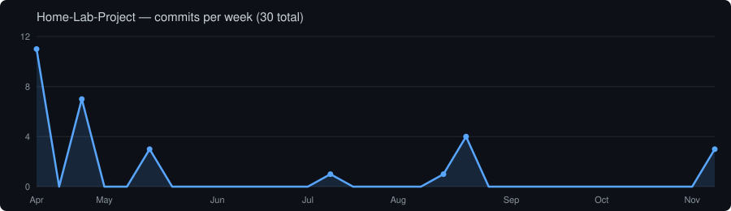
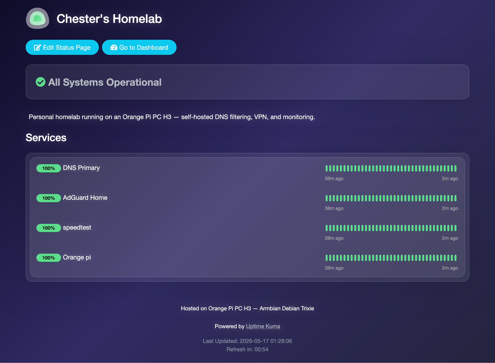

# 🏠 Homelab

**Self-hosted services on a single-board computer.** 
Notes on networking, Linux, and infrastructure as I learn them.

---

## 📈 Activity

## 🖥️ Hardware

| Component | Spec |
|---|---|
| **Board** | Orange Pi PC (Allwinner H3) |
| **RAM** | 1 GB DDR3 |
| **OS** | Armbian — Debian Trixie Minimal |
| **Storage** | MicroSD (SanDisk High Endurance) |

📄 [Initial setup notes →](configs/orange-pi/README.md)

## 🧰 Stack

| | Service | Purpose | Runtime | Docs |
|:-:|---|---|:-:|:-:|
| 🐳 | **Docker** | Container runtime | host | [→](configs/docker/README.md) |
| 🛡️ | **AdGuard Home** | Network-wide DNS filtering — ~83% block rate | container | [→](configs/adguard/README.md) |
| 🔐 | **Tailscale** | VPN exit node, extends filtering to mobile | host | [→](configs/tailscale/README.md) |
| 📊 | **Uptime Kuma** | Service + container health | container | [→](configs/uptime-kuma/README.md) |
| 🚫 | **Fail2ban** | SSH brute-force protection | host | [→](configs/fail2ban/README.md) |
| 🧱 | **UFW** | Host firewall, default-deny inbound | host | [→](configs/ufw/README.md) |
| 📝 | **LibreOffice** | Document conversion | host | [→](configs/libreoffice/README.md) |
| 🩺 | **Pi Health** | Live dashboard, alerts, app launcher — plus two anime themes | host | [→](apps/pi-health/README.md) |
| 💾 | **Backups** | Nightly archive, pulled off-board daily | host | [→](configs/backup/README.md) |

> ⏳ **Next up** — Nginx reverse proxy · Dell OptiPlex 3070

### 🔁 Rebuild from scratch

Order matters — later steps assume earlier ones are in place.

1. [Orange Pi setup](configs/orange-pi/README.md) — flash, first boot, SSH keys
2. [Docker](configs/docker/README.md) — frees port 53, installs the runtime
3. [AdGuard Home](configs/adguard/README.md) — restore from backup or start from [`AdGuardHome.example.yaml`](configs/adguard/AdGuardHome.example.yaml)
4. [Tailscale](configs/tailscale/README.md) — exit node + tailnet DNS
5. [Uptime Kuma](configs/uptime-kuma/README.md) — monitors for everything above
6. [Fail2ban](configs/fail2ban/README.md) — SSH jail
7. [UFW](configs/ufw/README.md) — firewall last, once you know every port in use
8. [Backups](configs/backup/README.md) — nightly archive + off-board copy
9. [Pi Health](apps/pi-health/README.md) — dashboard on port 8090 (needs its UFW rule)

## 🤔 Why I did it this way

<b>🌐 DNS</b>

AdGuard resolves upstream over DoH (Cloudflare, Quad9, Google), so queries leaving the network aren't visible to the ISP.

<b>📦 Containers where it helps</b>

AdGuard runs in Docker with config persisted to `/opt/adguardhome/`, which makes recovery after an SD card reflash trivial. Tailscale stays on the host; exit-node routing needs direct access to the host network stack.

<b>📊 Monitoring, sized to the hardware</b>

Grafana, Prometheus, and Netdata are all either too heavy for 1 GB of RAM or solving problems I don't have. Uptime Kuma answers the actual question: is it up? It watches AdGuard (HTTP + container), Tailscale, the Pi, DNS, and Speedtest Tracker via the Docker socket.

<b>🔒 Zero trust on a flat LAN</b>

Fail2ban bans an IP for an hour after 5 failed SSH attempts in 10 minutes. The network being "private" isn't a control.

## 🛠️ Build log

| # | Phase | What happened |
|:-:|---|---|
| 1 | **Setup** | Bought an Orange Pi PC listed as an "Orange Pi One." Flashed the vendor Ubuntu 20.04 image (EOL, unstable). Identified the real board by inspecting it physically. |
| 2 | **First stack** | AdGuard Home and Tailscale installed natively. Confirmed DNS filtering worked over VPN on mobile. |
| 3 | **OS migration** | Reflashed to Armbian Trixie. Backed up AdGuard config over `scp`, disabled `systemd-resolved` to free port 53, restored config. |
| 4 | **Docker migration** | Installed Docker CE from the official Debian repo, moved AdGuard into a container with persistent volumes. Config, credentials, and blocklists restored intact. |
| 5 | **Hardening** | Switched upstreams to DoH, verified resolution across all devices, assessed CVE-2026-31431 exposure. |
| 6 | **Monitoring** | Deployed Uptime Kuma, mounted the Docker socket for container health checks. |
| 7 | **SSH hardening** | Fail2ban with an SSH jail. Fixed a Tailscale MagicDNS vs system DNS conflict with `chattr +i` on `resolv.conf`. |
| 8 | **Firewall** | UFW with default-deny inbound and LAN-only allows; forward policy set to ACCEPT so the exit node keeps working. |

## 💥 Things that broke

| What happened | Fix |
|---|---|
| Board was mislabeled as "Orange Pi One" on Lazada | Identified the real model physically, reflashed correct Armbian image |
| `systemd-resolved` holding port 53 | Disabled it so AdGuard could bind |
| Tailscale MagicDNS overwriting `/etc/resolv.conf` | `chattr +i` to lock the file |
| Vendor Ubuntu 20.04 image unstable + EOL | Migrated to Armbian Debian Trixie |

## 🎯 Goals

Get hands-on with Linux, networking, and self-hosted infra. Document enough that future-me can rebuild this from scratch.

---

📝 Docs in this repo were structured with LLM assistance. Every step reflects work actually done on this hardware, including the parts that broke.

